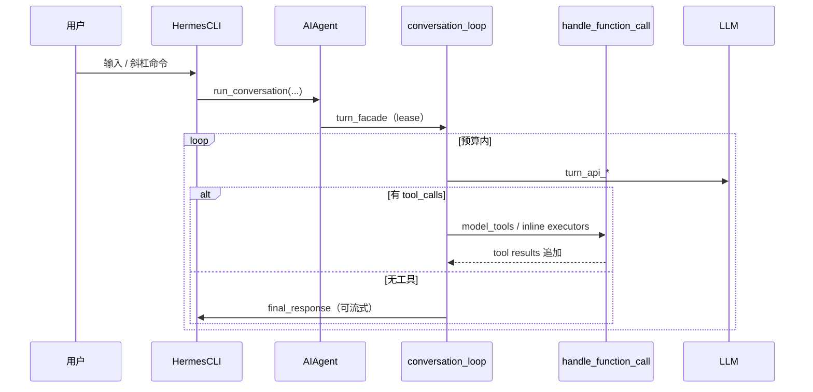

> 研究对象：`NousResearch/hermes-agent`（研读 `@c8aa560` / v0.21.1）+ [agentskills.io](https://agentskills.io) 开放规格  
> 伴生对照：SkillClaw、awesome-hermes-agent；产品对照：Claude Code / Cursor 的 skills 路径  
> 性质：**学习向**架构研读，不含新产品代码。

---

## 1. 一句话总览

Hermes 的腰很窄：**一个共享的 `AIAgent` 对话环**，被 CLI / TUI / Gateway / Cron / Desktop 共用；能力尽量长在边上（skills、plugins、MCP、终端后端）。

Agent Skills 则是跨产品的 **「文件夹 + SKILL.md」渐进披露格式**：启动只塞 name/description，真要用再读全文和脚本。Hermes **兼容这套格式**，并额外把它当成 **过程记忆**（会话里可自写、curator 治理）；Claude Code / Cursor 更偏 **人写、可移植、按目录发现**。

和[中转站架构笔记](../ai-relay-architecture/)对照：

| 中转站问题 | Hermes / Skills 问题 |
|------------|----------------------|
| 上游凭据存哪、谁持有出站 | 工具/技能谁能跑、网关谁能进 |
| Adaptor 改协议 | Skill 改「怎么做事」而不改核心环 |
| 多租户 Key | Profile / multiplex 隔离 + 通道 allowlist |

---

## 2. Hermes 模块地图

| 区域 | 职责 | 关键路径 |
|------|------|----------|
| **CLI** | REPL、斜杠命令、`HermesCLI` mixins | `cli.py`、`hermes_cli/` |
| **Agent 环** | turn lease → LLM → tools → 终态回复 | `run_agent.py`、`agent/conversation_loop.py`、`agent/turn_*.py` |
| **Gateway** | 多平台消息进程 | `gateway/run.py`、`gateway/platforms/`、`plugins/platforms/` |
| **Tools** | 注册表、toolset、后端 | `tools/`、`model_tools.py`、`toolsets.py` |
| **Skills** | 内置 / optional / Hub；渐进披露 | `skills/`、`tools/skills_tool.py`、`agent/skill_*.py`、`agent/curator.py` |
| **Memory** | 内置 + 可插拔 `MemoryProvider` | `agent/memory_manager.py`、`plugins/memory/` |
| **Cron** | 调度与投递（不镜像进聊天） | `cron/` |
| **Profiles** | 独立 `HERMES_HOME` 岛 | `hermes_cli/profiles.py`、`gateway/profile_routing.py` |
| **TUI / Desktop** | Ink TUI ↔ JSON-RPC；Electron | `ui-tui/`、`tui_gateway/`、`apps/desktop/` |
| **State** | SQLite 会话 / FTS | `hermes_state*.py` |

**设计不变量（仓库 `AGENTS.md`）：**  
1）按会话的 prompt cache 神圣不可乱拆；  
2）核心腰窄，能力放边缘。

### 2.1 技术栈

- Python `>=3.11,<3.14`，`uv` 锁版本  
- LLM：`openai` 核心 + Anthropic/Bedrock/Gemini/Codex 等适配  
- CLI：`prompt_toolkit` + `rich`；配置 YAML + 密钥 `.env`  
- TUI：React 19 + Ink（`ui-tui/`）  
- 扩展：plugins、MCP、ACP  

---

## 3. 路径 A：CLI/TUI → 模型 → 工具 → 回复



| 步骤 | 文件 / 符号 |
|------|-------------|
| 入口 | `hermes` → `hermes_cli.main:main` → `cli.py::HermesCLI` |
| 一轮聊天 | `hermes_cli/cli_chat_turn_mixin.py` → `agent.run_conversation` |
| 环 | `agent/turn_facade.py` → `agent/conversation_loop.py::run_conversation` |
| 工具 | `model_tools.py::handle_function_call`、`tools/registry.py` |
| TUI 同核 | `ui-tui` → JSON-RPC → `tui_gateway` → 同一 `AIAgent` |

---

## 4. 路径 B：消息 Gateway 入站 → 出站

### 4.1 通用（Telegram 插件型）

1. `plugins/platforms/<name>/adapter.py` 继承 `BasePlatformAdapter`  
2. SDK 回调 → `handle_message(MessageEvent)`（`gateway/platforms/base.py`）  
3. `GatewayRunner` → `_handle_message`（`run_inbound.py`）：pre hooks、authz、pairing、媒体  
4. `_handle_message_with_agent`（`run_turn.py`）→ `TurnRunner` → `agent.run_conversation`  
5. 流式消费 → `adapter.send()` / `gateway/delivery.py`  

### 4.2 Yuanbao（内置最完整的中间件管线）

文件：`gateway/platforms/yuanbao.py`  

默认管线（节选顺序）：

```text
Decode → ExtractFields → RecallGuard → Dedup → SkipSelf
→ ChatRouting → AccessGuard → ExtractContent → …
→ OwnerCommand → BuildSource → GroupAtGuard → AutoSetHome
→ GroupAttribution → … → Media → Dispatch
```

| 中间件 | 作用（排障对照） |
|--------|------------------------|
| **AccessGuard + AccessPolicy** | DM/群：`allowlist\|pairing\|open\|disabled`；`open` 需 `GATEWAY_ALLOW_ALL_USERS` / `YUANBAO_ALLOW_ALL_USERS`；multiplex 下副 profile 的 env 必须进 **secret scope**，否则静默拒群 |
| **GroupAtGuard** | 群消息未 `@bot`（且非 owner 命令）→ 只 **observe** 进 transcript，**不 dispatch**；日志常见 `Group message observed (no @bot)` |
| **GroupAttribution** | `@bot` 通过后打 `[nickname\|user_id]` + channel_prompt |
| **Dispatch** | 入队 → `Group message enqueued` → `handle_message` |

Transport：WebSocket `ConnectionManager`；`enforces_own_access_policy = True`。  
技能伴生：`optional-skills/yuanbao/SKILL.md`（`yb_query_group_*` 等）。

---

## 5. Profiles 与 multiplex

| 概念 | 行为 |
|------|------|
| `HERMES_HOME` | 默认 `~/.hermes`；命名 profile → `~/.hermes/profiles/<name>/` |
| 隔离 | 每个 profile 自有 `config.yaml`、`.env`、`skills/`、`state.db`（岛，不在线继承） |
| `profile_routes` | 按 platform / guild / chat / thread 匹配 profile |
| `gateway.multiplex_profiles` | **一个进程**服务多 profile |
| **密钥作用域** | multiplex 下 `os.environ` 往往是 **default**；副 profile 的 allowlist / `ALLOW_ALL` 走 `agent/secret_scope.py`；**scope miss 失败关闭**，不借 default 的名单 |

典型坑：在副 profile 里配置了 `YUANBAO_ALLOW_ALL_USERS` 仍不生效——multiplex 下副 profile 的授权读错了层。

---

## 6. 终端后端与隔离（七种）

`tools/terminal_tool_backends.py`：

1. `local`（默认，**无 OS 边界**）  
2. `docker`  
3. `singularity`  
4. `modal`  
5. `daytona`  
6. `vercel_sandbox`  
7. `ssh`  

**隔离模型（`SECURITY.md`）：** 终端后端只约束 shell/文件类工具；**不**约束进程内 code-exec、MCP 子进程、插件、skill import。真正对抗边界要靠整进程 Docker/OpenShell。审批门控是启发式，不是安全边界。

---

## 7. Agent Skills 开放规格

### 7.1 是什么

官网：https://agentskills.io · 规格仓：https://github.com/agentskills/agentskills  

一个技能 = 目录 + 必需的 `SKILL.md`（YAML frontmatter + Markdown 正文）+ 可选 `scripts/`、`references/`、`assets/`。

| Frontmatter | 必需 | 要点 |
|-------------|------|------|
| `name` | 是 | ≤64；小写+连字符；宜与目录名一致 |
| `description` | 是 | ≤1024；**做什么 + 何时用**（触发词） |
| `license` / `compatibility` / `metadata` | 否 | 元数据 |
| `allowed-tools` | 否 | 实验性预批准工具 |

### 7.2 渐进披露（调用契约）

1. **Catalog**：启动只加载 name+description（约几十 token/技能）  
2. **Activation**：匹配后读完整 `SKILL.md`  
3. **Resources**：脚本/参考按需再读  

用户可 `/skill-name`；实现可用 file-read 或专用工具。

### 7.3 发现路径（规格不强制，产品约定）

| Scope | 常见路径 |
|-------|----------|
| Project | `.〈client〉/skills/` 或跨工具 `.agents/skills/` |
| User | `~/.〈client〉/skills/` 或 `~/.agents/skills/` |

扫描：子目录存在精确 `SKILL.md`；同名时 project > user；未信任仓库建议门禁后再加载。

### 7.4 三产品对照

| | Claude Code | Cursor | Hermes |
|--|-------------|--------|--------|
| 路径 | `~/.claude/skills/`、`.claude/skills/` | `.agents|.cursor/skills/` + home；兼容扫描 `.claude|.codex` | `~/.hermes/skills/`；external/project（需 trust）；Hub |
| 扩展字段 | `context:fork`、`allowed-tools`、动态 `!cmd` 等 | `paths`、Custom Mode 外观 | `platforms`、`metadata.hermes.*` |
| 特色 | 人写 + 强产品扩展 | monorepo 子树 scope；Cloud 仅 sync `~/.cursor/skills/` | **过程记忆**：`skill_manage`、`/learn`、`write_approval`、curator |
| API | Skill tool / `/name` | 自动 + `/` | `skills_list` → `skill_view` |

**可移植边界：** 规格六字段可跨产品；产品私有 frontmatter 对方可能忽略或报错。跨工具共享优先 `.agents/skills/`。

---

## 8. Hermes 里的 Skills：加载、自写、Curator

| 主题 | 细节 |
|------|------|
| 落盘 | 运行时 `$HERMES_HOME/skills/`（从仓库 `skills/` 播种）；小众 `optional-skills/` 经 `hermes skills install`；Hub：`tools/skills_hub*.py` |
| 格式 | agentskills 形 + Hermes 元数据 |
| 加载 | 渐进：`skills_list` / `skill_view`（`tools/skills_tool.py`）；斜杠注入为 **user message**（`agent/skill_commands.py`），**不进 system prompt** |
| 自写 | 复杂任务后 agent 可 `skill_manage`；可选 `skills.write_approval` |
| Curator | `agent/curator.py`；`hermes curator …`；用量 `~/.hermes/skills/.usage.json`；仅 **agent 创建** 的技能可自动归档到 `.archive/`；不硬删；pinned 豁免 |
| 护栏 | `tools/skills_guard.py` 启发式；Hub quarantine；项目技能扫描 |

### 8.1 SkillClaw（伴生，可选）

https://github.com/AMAP-ML/SkillClaw · 论文 arXiv:2604.08377  

两环：任务中 Hermes 写技能 + 任务后 Evolve Server（去重/提质）；可 `skillclaw setup` 改 Hermes 走本地 proxy，库仍在 `~/.hermes/skills`。格式仍是 SKILL.md，亦可服务 Codex/Claude Code 等。

---

## 9. 人写 vs 会话自写（怎么用才稳）

| | 人写可移植 Skill | Hermes 自写（± SkillClaw） |
|--|------------------|----------------------------|
| 优点 | 可审计、可 git、跨 Cursor/Claude/Hermes | 从真实成功路径生长、贴合个人工作流 |
| 风险 | 更新慢 | 半成品重复、供应链（指令+脚本）、权限面 |
| 建议 | 核心 SOP / 发布用 | 过程记忆；开 `write_approval`；定期 curator；装 Hub 前通读脚本 |

跑技能前清单：来源/hash → 通读 SKILL.md → 查 `scripts/` → 权限与 `allowed-tools` → 项目 trust → 沙箱试跑 → 自写审批 / 可回滚。参考：[Install agent skills without getting owned](https://www.nyk.dev/blog/install-agent-skills-without-getting-owned)。

---

## 10. 信任面汇总（Hermes）

| 面 | 风险 | 控制思路 |
|----|------|----------|
| 凭据 | `.env`、bot token、provider key | secrets-only `.env`；multiplex secret scope；子进程 scrub |
| 插件 | 等同 agent 进程权限 | 安装前人工审 |
| Gateway | 未授权远程调度 | 各平台 allowlist；yuanbao AccessPolicy；缺名单 fail-closed |
| Skills | import/脚本任意代码 | Skills Guard、quarantine、审批、curator 边界 |
| 终端 | local 无 OS 边界 | docker 等后端；整进程沙箱才是真边界 |
| 审批门控 | 启发式 | 勿当安全边界 |

---

## 11. 自建 / 自用可抄清单（不写码）

1. **一个对话环，多入口挂载**（CLI/网关/定时共用核）  
2. **网关用中间件管线**表达策略（鉴权 → 路由 → @门控 → dispatch），日志每层可观测  
3. **Profile = 文件系统岛**；多租户密钥 **scope fail-closed**  
4. **Skills = 规格六字段 + 渐进披露**；产品扩展字段单独命名空间（如 `metadata.hermes`）  
5. **人写 SOP + agent 过程记忆** 分库或分目录，自写必须审批  
6. **终端默认勿 local 裸奔**（若暴露到消息网关）  
7. 能力增长优先 **skill/plugin**，少改核心 loop（保持 prompt cache 友好）  

---

## 12. 与「中转站笔记」的衔接

- 若你自建 **可信 API 网关**：抄 One/New Adaptor，别抄 Sub2API/A2 的客户端模拟主路径。  
- 若你自建 **可信 Agent**：抄 Hermes 的「窄腰 + 边缘能力 + 中间件网关」；技能层跟 agentskills.io，便于和 Cursor/Claude 共用 SOP。  
- Yuanbao 排障经验：群策略 / @门控 / multiplex 密钥作用域（见路径 B），可当网关设计的回归用例。

---

## 13. 不确定点

- Curator 在默认发行版的 cron/触发默认是否开启、阈值因配置而异  
- 各 messaging 插件与 yuanbao 内置管线的同构程度不一（Telegram 更「薄」）  
- SkillClaw 与原生 curator 同时开时的职责划分需实操验证  
- agentskills 实验字段 `allowed-tools` 在各客户端支持度不一  

---

## 14. 结论

Hermes = **共享 agent 环** + **边缘 skills/plugins/MCP** + **（可选）厚网关中间件**。  
Agent Skills = **跨产品的技能文件合约**；Hermes 在其上叠加 **自写过程记忆与 curator**。  

拆完这两块，就同时摸到了「消息怎么进 agent」和「能力怎么不写死在核心里」。下一步若要落地，可以：  
（a）把运维 SOP 收成 `.agents/skills/` 人写技能；或  
（b）画一页「自用窄腰 agent」架构再写最小环。
