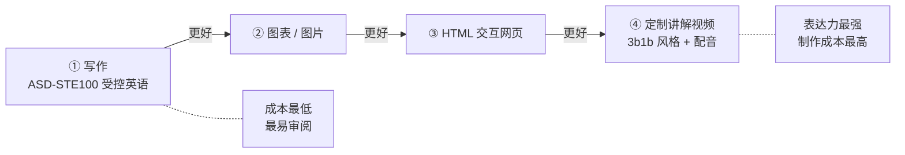
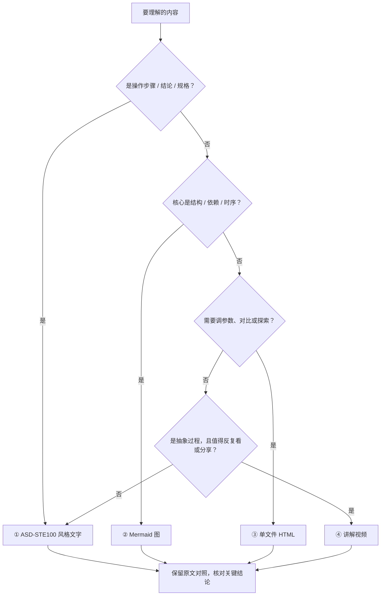
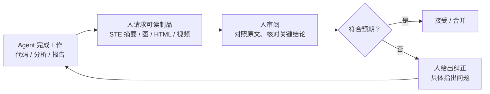
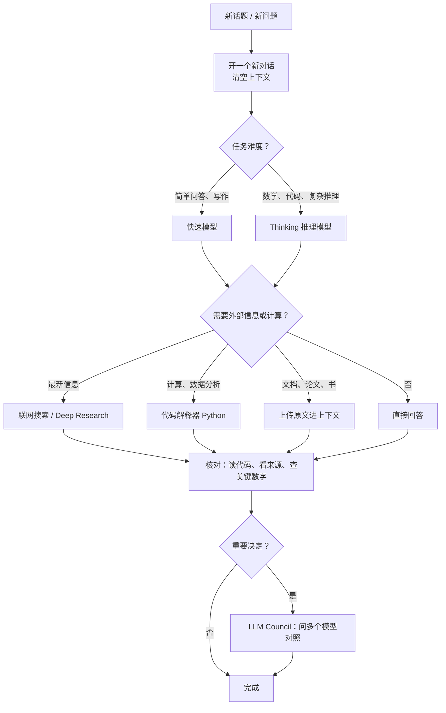

> 来源：Andrej Karpathy 2026-10-02 的 [X 帖子](https://x.com/karpathy/status/2105819303471976479)（全文整理见 [Way Into AI](https://wayintoai.com/ref/karpathy-efficient-ways-to-get-llms-to-explain)）；ASD-STE100 规则引自官方 [ASD-STE100 Issue 9](https://www.asd-ste100.org/assets/files/ASD-STE100_ISSUE9.pdf)；日常技巧来自他 2025-02-27 发布的视频 [How I use LLMs](https://www.youtube.com/watch?v=EWvNQjAaOHw)。
>
> 说明：标注“【个人补充】”的内容是我的理解与实践建议，不是 Karpathy 原话。

## 为什么要关心“怎么让 LLM 讲明白”

Karpathy 帖子的出发点是：**我们会花越来越多的时间去理解语言模型的输出。**

- **模型在做越来越多的“体力活”**。写代码、查资料、跑分析，越来越多由 agent 自主完成；人的工作会“沿着抽象层往上走”，变成 **监督（oversight）与理解（understanding）**。
- **瓶颈从“产出”变成“读懂”**。Agent 一晚上能产出几千行 diff、几十页报告，人能不能快速、准确地看懂，决定了监督是否有效。
- **好在 LLM 本身也能帮忙**。智能和代码越来越廉价，你可以要“**大型、定制、用完即弃**”的软件制品——一个只为解释这一次改动的交互网页、一段只给你自己看的讲解视频。以前这种东西做起来太贵，根本不值得；现在值得了。

他给出的办法是一个逐级升级的输出格式阶梯，每一级都“But even better”：



---

## 阶梯一：写作 → 用 ASD-STE100

### 原文要点

让 LLM 用 **ASD-STE100** 解释东西。它是一套受控语言规范，最初为航空维修文档开发。Karpathy 说 LLM 很熟悉这套规范，而它对“干净的写作风格”有很重的约束，读起来往往更易懂。规范太严时可以放松：要求 **“80% of the way to ASD-STE100”**。

### ASD-STE100 到底约束了什么

ASD-STE100（Simplified Technical English，简化技术英语）由 ASD（欧洲航空航天与防务工业协会）维护，当前为 Issue 9。以下规则摘自官方规范原文：

| 类别 | 规则（官方条款） |
|------|------------------|
| 词汇 | 只用**词典批准的词**（Rule 1.1）；一般来说**每个词只有一个含义、一个词性**——例如 *fall* 只表示“受重力向下移动”，不表示“下降/减少”；同义词只保留一个，如只用 *start*，不用 *begin / commence / initiate* |
| 语态 | **使用主动语态**；描述性文字中只有在不知道动作发出者时才可用被动（Rule 3.6） |
| 过程性句子（操作步骤） | **每句最多 20 词**（Rule 5.1）；**每句只写一条指令**，除非多个动作同时发生（Rule 5.2） |
| 描述性句子 | **每句最多 25 词**（Rule 6.3）；**逐步给出信息**（Rule 6.1）；用关键词组织逻辑结构（Rule 6.2） |
| 段落 | **每段只讲一个主题**（Rule 6.5）；**每段不超过六句**（Rule 6.6） |
| 衔接 | 用连接词把相关主题的句子连起来（Rule 4.4） |

> 注：常见的“一句一个主题”说法，在官方规范里对应的是“过程性句子一句一条指令”和“段落一个主题”；严格说并没有单独的“一句一个主题”条款。

**为什么它对“读懂 LLM 输出”有效**【个人补充】：

1. **短句 = 低工作记忆负担**。20/25 词上限迫使模型把长难句拆开，每句只承载一个信息点。
2. **一词一义 = 消除歧义**。LLM 平时爱用同义词换着说，读者会怀疑“这两个词是不是两回事”；受控词汇把这种噪音砍掉。
3. **主动语态 = 谁做了什么一目了然**。“配置被加载”变成“服务加载配置”，责任主体清楚。
4. **逐步给信息 = 天然的结构**。先结论、再细节，正好适合审阅。
5. **难以藏住“空话”**。在严格的格式下，含糊、绕弯的表述很难伪装成内容。

### 改写示例（Before / After）

**Before（典型的 LLM 风格）：**

> The caching layer, which was introduced in order to mitigate the latency issues that were being experienced by users during peak traffic periods, leverages a write-through strategy that ensures data consistency is maintained between the cache and the underlying database, although it should be noted that cache invalidation may occasionally be delayed under certain conditions.

一句 60 多个词，三处被动，*leverage / mitigate* 这类非批准词，还把“为什么引入、怎么工作、有什么问题”塞进同一句。

**After（接近 ASD-STE100）：**

> The cache decreases latency during peak traffic. It uses a write-through strategy. Each write goes to the cache and to the database at the same time. Thus, the data in the cache and the data in the database stay the same. Sometimes the system removes old cache data late. This can occur when the load is high.

每句一个信息点、主动语态、都在 25 词以内。【个人补充】最后一句的“when the load is high”是改写时补上的具体条件——原文只写了 “under certain conditions”。**这正是风险点**：改写会让模型倾向于把模糊表述“具体化”，你必须核对它补的条件是否真实（见下文“注意事项”）。

### Prompt 模板

**English：**

```text
Explain the following in ASD-STE100 Simplified Technical English
(about 80% of the way to strict STE: keep technical terms, allow common words if needed).
Rules: active voice; max 20 words per instruction, max 25 words per descriptive sentence;
one instruction per sentence; one topic per paragraph, max 6 sentences;
use one word for one meaning and keep it consistent.
Do not add facts, numbers, or conditions that are not in the source.
Keep all technical terms, identifiers, and code unchanged.

<content>
```

**中文（适合中文读者的“受控中文”变体）【个人补充】：**

```text
请用接近 ASD-STE100 的风格解释下面的内容，输出中文：
- 用主动语态，明确“谁做了什么”；
- 操作步骤一步一句、每句只有一个动作；说明性句子尽量短（约 40 字以内）；
- 每段只讲一个主题，不超过 6 句；
- 同一个概念始终用同一个词，不要换同义词；
- 技术术语、标识符、代码、数字和条件原样保留，不要补充原文没有的事实。

<内容>
```

---

## 阶梯二：图表 / 图片

### 原文要点

别要文字，让 LLM **画图**。图更容易处理、解析和理解。

### 为什么有效【个人补充】

- **结构外显**：依赖关系、时序、状态转换这类信息，本来就是“图形状”的；用文字表达等于让读者在脑子里重建图。
- **一眼发现异常**：环形依赖、孤立节点、缺失的分支，在图上非常显眼，在文字里很容易被略过。
- **可审阅、可 diff**：让模型输出 **Mermaid / Graphviz / PlantUML** 这类“图即代码”，既能渲染，又能放进 Git 跟踪变化（本文的图就是 Mermaid）。

### Prompt 模板

```text
Draw a diagram that explains <topic>. Output Mermaid code only.
Pick the best diagram type (flowchart / sequenceDiagram / stateDiagram / classDiagram).
Max 15 nodes. Label every edge with the action or data that flows.
Mark anything you are unsure about with "?" in the label.
```

```text
用一张图解释 <主题>，只输出 Mermaid 代码。
自行选择最合适的类型（流程图 / 时序图 / 状态图 / 类图）；
节点不超过 15 个；每条边标注发生的动作或流动的数据；
不确定的地方在标签里加“?”。
```

---

## 阶梯三：HTML 网页

### 原文要点

要求输出 **“in HTML”**，得到漂亮、可交互的网页。LLM 的前端能力越来越强，能做出漂亮的体验和动画。

### 为什么有效【个人补充】

- **交互 = 让读者自己探索**：滑块调参数、折叠细节、悬停看定义，读者按自己的节奏理解，而不是被动读一长段。
- **单文件、零依赖、可丢弃**：一个 HTML 文件双击就能打开；看完就扔，不需要“维护”。
- **多种表达组合**：一页里可以同时有文字摘要、图、表格、可运行的小例子。

### Prompt 模板

```text
Create a single self-contained HTML file (inline CSS/JS, no external requests)
that explains <topic> interactively.
Include: a 3-sentence summary at the top, one interactive element
(slider / toggle / step-through) that shows how <key variable> changes the result,
and a "Sources & assumptions" section listing what is from the input vs. what you assumed.
```

```text
做一个单文件 HTML（CSS/JS 内联，不请求任何外部资源），交互式讲解 <主题>：
- 顶部 3 句话摘要；
- 至少一个交互元素（滑块 / 开关 / 分步播放），展示 <关键变量> 如何影响结果；
- 底部“来源与假设”区，区分哪些来自输入、哪些是你的假设。
```

> 安全提示【个人补充】：打开前先看一眼代码，确认没有外部请求或可疑脚本；要求“no external requests”也能顺便保护隐私。

---

## 阶梯四：定制讲解视频

### 原文要点

Karpathy 最看好的输出形式：**针对任意主题完全定制的讲解视频**。可以试：

> Create a 3b1b style video explainer on X. Use my ElevenLabs API key for audio narration.

配音需要 API Key；也可以让 LLM 帮你找能用本地算力的免费替代方案。他说这“真的开始能用了”。

### 为什么有效【个人补充】

- **时间维度**：动画能一步步展示过程（算法的每一步、数据怎么流动），这是静态图做不到的。
- **双通道**：画面 + 旁白同时进入，适合抽象、数学化的概念（3Blue1Brown 风格正是以此著称）。
- **门槛在快速下降**：模型能写动画代码（例如 3b1b 开源的 Manim 库），再调用 TTS 合成配音、拼成视频。

### Prompt 模板

```text
Create a 3Blue1Brown-style explainer video on <topic>, about 2–3 minutes.
1. Write a narration script first (short sentences) and show it to me for approval.
2. Then write Manim (Python) code for the animation, one scene per script section.
3. For narration, use <ElevenLabs with my API key | a free local TTS model you recommend>.
4. Combine audio and video with ffmpeg. Give me the exact commands to run.
```

```text
为 <主题> 做一个 3Blue1Brown 风格的讲解视频，约 2–3 分钟：
1. 先写旁白脚本（短句），给我确认；
2. 再用 Manim（Python）写动画，每段脚本对应一个场景；
3. 配音使用 <我的 ElevenLabs API Key | 你推荐的本地免费 TTS>；
4. 用 ffmpeg 合成音视频，并给出可直接运行的命令。
```

---

## 怎么选：按内容类型挑输出格式【个人补充】

阶梯是“越往上越好”，但不是每次都要爬到顶。成本、审阅速度和内容形状都要考虑：



---

## 注意事项【个人补充】

1. **保留原文对照**。改写、画图、做网页都是“有损翻译”；把原始输出（日志、diff、原文）放在旁边，遇到疑问回到原文。
2. **术语和条件不能丢**。简化最容易误伤的是限定条件（“仅在……时”“除非……”）和专有术语；在 prompt 里明确要求原样保留。
3. **承重结论必须核实**。任何你要据此做决定的数字、因果、结论，回到源头验证；模型会为了“讲清楚”而补全它并不知道的细节（见上面的 Before/After 例子）。
4. **隐私与托管 TTS**。把内部代码、文档的讲解稿发给 ElevenLabs 这类托管服务，等于把内容交给第三方；敏感材料用本地 TTS，API Key 不要写进脚本或提交进仓库。
5. **用完即弃，别维护**。这些制品的价值在“这一次理解”；需要长期留存的，再整理成正式文档。

---

## 背后的“为什么”：监督循环

把上面串起来，就是 Karpathy 所说的“人的工作上移到监督与理解”的一个具体闭环：



关键在 B：**不是去读 agent 的原始产出，而是让它为你生成一个“专门用来理解”的制品**——而这种制品现在已经便宜到可以每次都做一个。

---

## How I use LLMs：Karpathy 的日常工作流

视频 [How I use LLMs](https://www.youtube.com/watch?v=EWvNQjAaOHw)（2025-02-27）是一份面向大众的实用指南。以下要点均能在视频中找到对应内容：



### 1. 一个话题开一个新对话

上下文窗口是模型的“工作记忆”。换话题时开新对话，把 token 清零。原因有二：大量无关 token 会**分散模型注意力**、降低准确度；token 越多，生成也**越慢、越贵**。

实践【个人补充】：长任务做到一半感觉模型“变笨”，先让它总结当前进度，再把总结贴进新对话继续。

### 2. 按任务选模型，并知道自己在用哪个

不同档位、不同厂商的模型能力差别很大（他特别提醒免费档往往是更小的模型）。**简单问题用普通模型**，**数学、代码、复杂推理用 thinking 模型**——它们会“想”更久，难题上更准；简单问题则没必要。

### 3. 用工具，而不是让模型“心算”

模型本身只是“一个 zip 文件”，没有计算器、没有浏览器。所以：

- 需要**最新信息**时，用带搜索的模型或 Deep Research，并去看引用来源；
- 需要**计算 / 数据分析**时，让它写代码并在解释器里运行。

视频里有个例子：他让 ChatGPT 拟合估值趋势外推到 2030 年，模型嘴上说约 1.7 万亿，但代码里实际算出来的变量约 20 万亿——两者不一致。他的结论是：**一定要读它写的代码、核对结果**。

### 4. 把上下文直接给它

读论文、读书时，**把原文上传进上下文**，再一起读、让它解释、回答问题，而不是指望模型凭训练记忆回答。

### 5. 记忆与自定义指令

ChatGPT 等产品可以在对话间记住关于你的信息（memory），也可以在设置里写 **custom instructions**（例如希望的语气、你的背景），对所有对话全局生效，省去每次重复说明。

### 6. LLM Council：多个模型一起问

他会订阅多家模型，把**同一个问题问所有模型**，称之为自己的“**LLM Council**”（例如决定去哪度假时）。后来他把这个思路做成了开源项目 [llm-council](https://github.com/karpathy/llm-council)：多个模型分别作答、互相评审，再由一个“主席”模型汇总。

### 7. 其他他提到的用法（简列）

语音输入与原生语音对话（Advanced Voice Mode）、NotebookLM 把资料生成播客、在 Cursor 这类编辑器里写代码、用 Claude Artifacts 生成小应用（如抽认卡）。

---

## 小结

- **问题**：agent 产出越来越多，人的瓶颈变成“读懂与监督”。
- **方法**：让 LLM 用更易懂的形式输出——受控英语 → 图 → 网页 → 视频，按内容挑选。
- **底线**：保留原文、保住术语和条件、核实承重结论、注意隐私。
- **日常**：新话题新对话、按任务选模型、用工具不心算、给足上下文、善用记忆、重要问题开“议会”。
